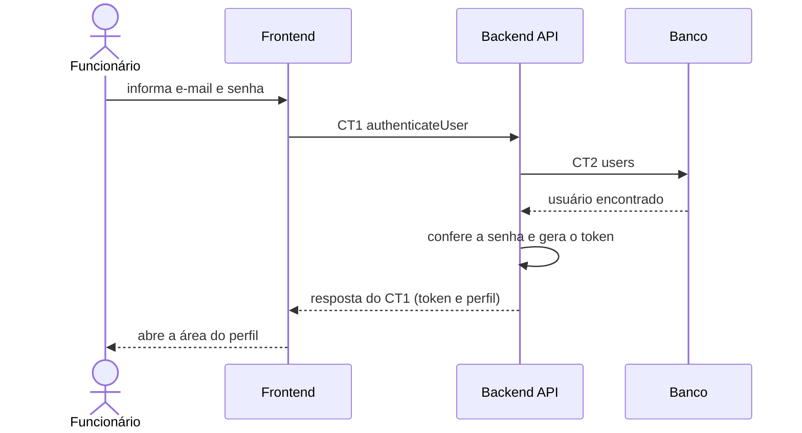

# Fluxo do E1: Cadastro e autenticação de usuários

**Feito quando (da Entrega 1):** O usuário cadastrado informa e-mail e senha e acessa a plataforma de acordo com seu perfil; credenciais inválidas exibem uma mensagem de erro.

## Passos

1. O funcionário abre a tela de login, informa e-mail e senha e clica em "Entrar".
2. O Frontend chama o Backend API com a operação `authenticateUser` (CT1).
3. O Backend API busca o usuário pelo e-mail na tabela `users` (CT2).
4. O Backend API confere a senha informada com o hash gravado e gera o token de sessão.
5. O Backend API responde ao Frontend com o token e o perfil do usuário (Funcionário, Técnico ou Administrador).
6. O Frontend guarda o token e abre a área correspondente ao perfil.

> O mesmo caminho vale para Técnico e Administrador; só muda a área aberta no passo 6. Credenciais inválidas estão na tabela de erros do CT1.

## Diagrama

## Contratos usados

| ID | Nome | De → Para |
|:---|:---|:---|
| CT1 | `authenticateUser` | Frontend → Backend API |
| CT2 | `users` | Backend API → Banco |
