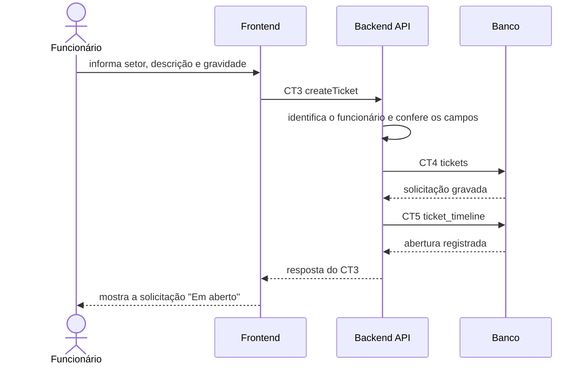

# Fluxo do E2: Abertura de solicitação de suporte

**Feito quando (da Entrega 1):** O funcionário informa setor, descrição e gravidade e a solicitação aparece como "Em aberto", vinculada ao funcionário que a criou.

## Passos

1. O funcionário abre o formulário de nova solicitação, informa setor, descrição e gravidade e clica em "Enviar".
2. O Frontend chama o Backend API com a operação `createTicket` (CT3), enviando o token da sessão.
3. O Backend API identifica o funcionário pelo token e confere se os campos obrigatórios foram preenchidos (setor/categoria, descrição e gravidade).
4. O Backend API grava a solicitação na tabela `tickets` (CT4) com o estado "Em aberto" e o funcionário como solicitante.
5. O Backend API registra a abertura na tabela `ticket_timeline` (CT5).
6. O Backend API responde ao Frontend com a solicitação criada.
7. O Frontend mostra a solicitação como "Em aberto" na área do funcionário.

## Diagrama

## Contratos usados

| ID | Nome | De → Para |
|:---|:---|:---|
| CT3 | `createTicket` | Frontend → Backend API |
| CT4 | `tickets` | Backend API → Banco |
| CT5 | `ticket_timeline` | Backend API → Banco |
