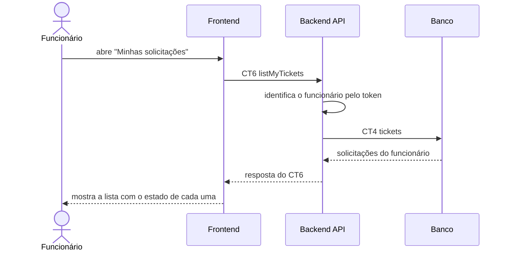

# Fluxo do E3: Listagem de solicitações do funcionário

**Feito quando (da Entrega 1):** O funcionário acessa sua área e visualiza as solicitações que abriu, identificando o estado atual de cada uma.

## Passos

1. O funcionário abre a página "Minhas solicitações".
2. O Frontend chama o Backend API com a operação `listMyTickets` (CT6), enviando o token da sessão.
3. O Backend API identifica o funcionário pelo token.
4. O Backend API busca na tabela `tickets` (CT4) as solicitações em que ele é o solicitante.
5. O Backend API responde ao Frontend com a lista e o estado de cada solicitação.
6. O Frontend mostra a lista com o estado de cada uma ("Em aberto", "Em atendimento" ou "Resolvido").

## Diagrama

## Contratos usados

| ID | Nome | De → Para |
|:---|:---|:---|
| CT6 | `listMyTickets` | Frontend → Backend API |
| CT4 | `tickets` | Backend API → Banco |
