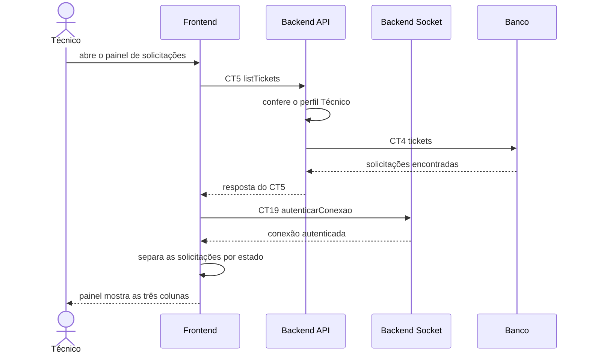

# Fluxo do E4: Painel de solicitações para técnicos

**Feito quando (da Entrega 1):** O técnico acessa o painel e visualiza as solicitações disponíveis, separadas entre "Em aberto", "Em atendimento" e "Resolvido".

## Passos

1. O técnico abre o painel de solicitações.
2. O Frontend chama o Backend API com a operação `listTickets` (CT5), enviando o token da sessão.
3. O Backend API confere se o usuário do token tem o perfil Técnico (`SUPPORT` ou `ADMIN`).
4. O Backend API busca as solicitações na tabela `tickets` (CT4).
5. O Backend API responde ao Frontend com as solicitações e o estado de cada uma.
6. O Frontend autentica no Backend Socket via WebSocket com a operação `autenticarConexao` (CT19) para receber novos chamados em tempo real.
7. O Frontend separa as solicitações pelos três estados.
8. O painel mostra as colunas "Em aberto", "Em atendimento" e "Resolvido".

## Diagrama

## Contratos usados

| ID | Nome | De → Para |
|:---|:---|:---|
| CT5 | `listTickets` | Frontend → Backend API |
| CT4 | `tickets` | Backend API → Banco |
| CT19 | `autenticarConexao` | Frontend → Backend Socket |
