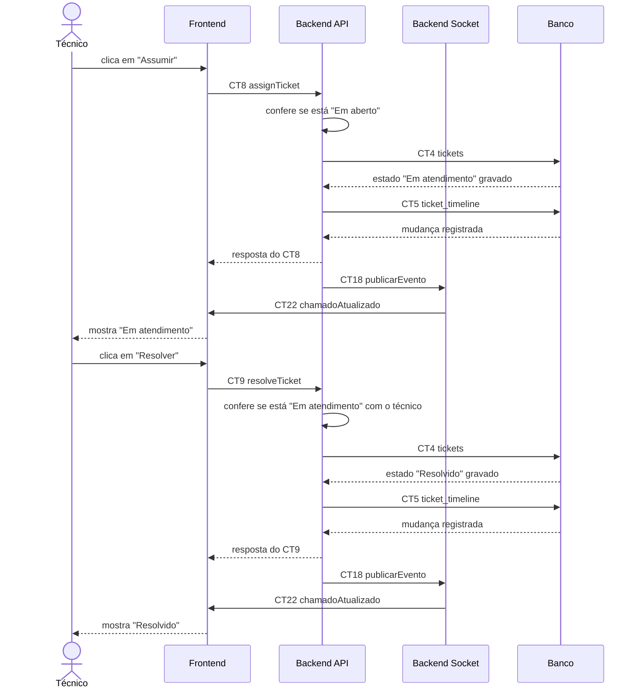

# Fluxo do E5: Atendimento e alteração de estado

**Feito quando (da Entrega 1):** O técnico assume uma solicitação "Em aberto", que passa para "Em atendimento", e consegue encerrá-la alterando seu estado para "Resolvido".

## Passos

1. O técnico abre uma solicitação "Em aberto" no painel e clica em "Assumir".
2. O Frontend chama o Backend API com a operação `assignTicket` (CT8).
3. O Backend API confere se a solicitação ainda está "Em aberto", grava o estado "Em atendimento" com o técnico responsável na tabela `tickets` (CT4) e registra a mudança na tabela `ticket_timeline` (CT5).
4. O Backend API responde ao Frontend com a solicitação atualizada.
5. O Backend API avisa o Backend Socket via TCP interno com a operação `publicarEvento` (CT18).
6. O Backend Socket envia o evento `chamadoAtualizado` (CT22) via WebSocket para as telas abertas dos técnicos, que movem o chamado para a nova coluna sem recarregar a página.
7. Ao terminar o atendimento, o técnico clica em "Resolver".
8. O Frontend chama o Backend API com a operação `resolveTicket` (CT9).
9. O Backend API confere se a solicitação está "Em atendimento" com esse técnico, grava o estado "Resolvido" em `tickets` (CT4) e registra a mudança em `ticket_timeline` (CT5).
10. O Backend API responde ao Frontend e avisa o Backend Socket via `publicarEvento` (CT18), que envia `chamadoAtualizado` (CT22) para as telas abertas.

## Diagrama

## Contratos usados

| ID | Nome | De → Para |
|:---|:---|:---|
| CT8 | `assignTicket` | Frontend → Backend API |
| CT9 | `resolveTicket` | Frontend → Backend API |
| CT4 | `tickets` | Backend API → Banco |
| CT5 | `ticket_timeline` | Backend API → Banco |
| CT18 | `publicarEvento` | Backend API → Backend Socket |
| CT22 | `chamadoAtualizado` | Backend Socket → Frontend |
