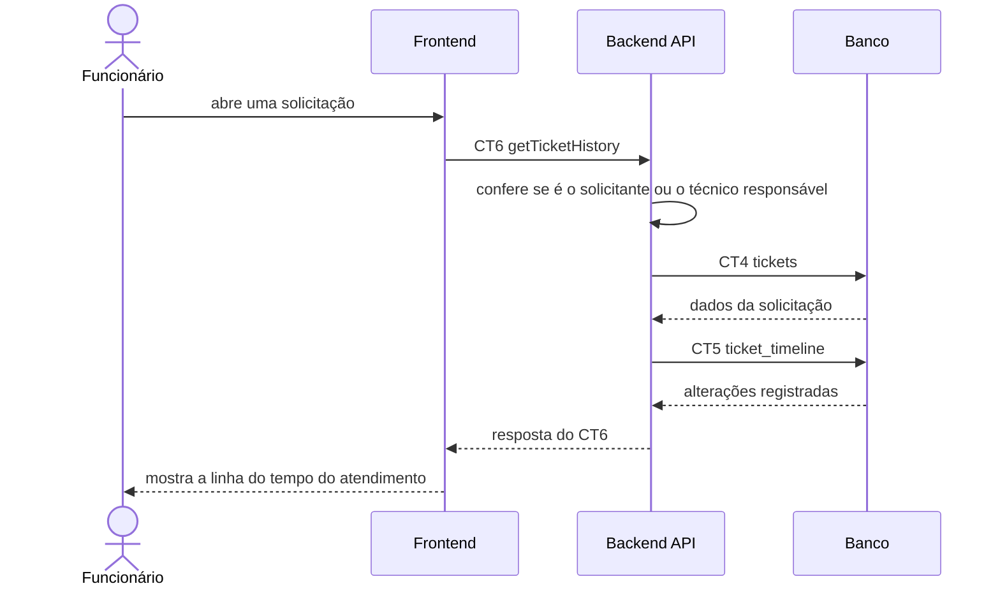

# Fluxo do E6: Histórico do atendimento

**Feito quando (da Entrega 1):** Funcionário e técnico acessam uma solicitação e conseguem consultar as alterações registradas durante aquele atendimento.

> Era o E7 na Entrega 1. Com a remoção do chat em tempo real, o histórico passa a mostrar só as alterações registradas (abertura, quem assumiu e mudanças de estado).

## Passos

1. O funcionário abre uma das suas solicitações.
2. O Frontend chama o Backend API com a operação `getTicketHistory` (CT6), enviando o token da sessão.
3. O Backend API confere se o usuário do token é o solicitante ou o técnico responsável pela solicitação.
4. O Backend API busca os dados da solicitação na tabela `tickets` (CT4).
5. O Backend API busca as alterações daquela solicitação na tabela `ticket_timeline` (CT5).
6. O Backend API responde ao Frontend com a solicitação e as alterações em ordem cronológica.
7. O Frontend mostra a linha do tempo do atendimento.

> O mesmo caminho vale para o técnico responsável.

## Diagrama

## Contratos usados

| ID | Nome | De → Para |
|:---|:---|:---|
| CT6 | `getTicketHistory` | Frontend → Backend API |
| CT4 | `tickets` | Backend API → Banco |
| CT5 | `ticket_timeline` | Backend API → Banco |
