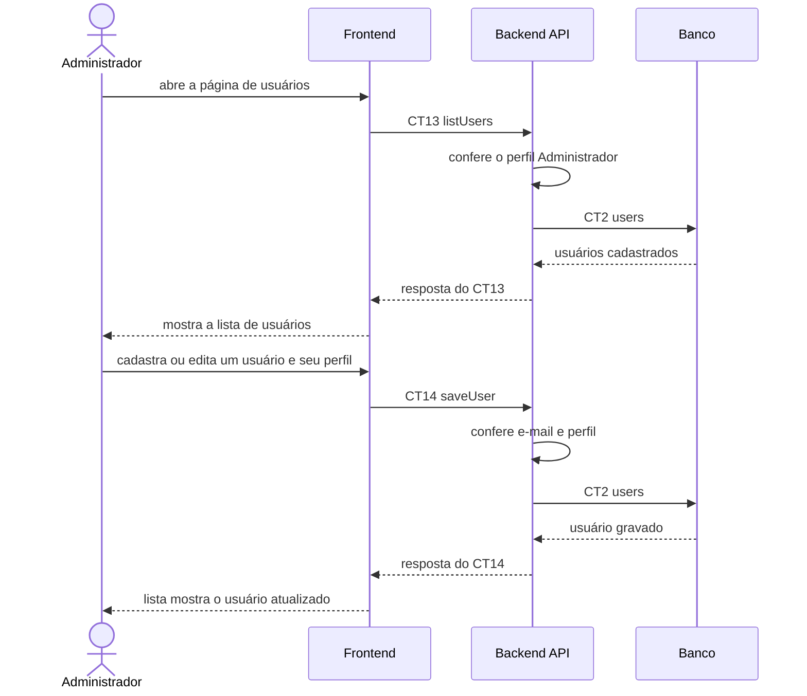

# Fluxo do E7: Gerenciamento de usuários

**Feito quando (da Entrega 1):** O administrador visualiza os usuários cadastrados e consegue cadastrar, editar e controlar os usuários e seus respectivos perfis.

> Era o E8 na Entrega 1.

## Passos

1. O administrador abre a página de usuários.
2. O Frontend chama o Backend API com a operação `listUsers` (CT13).
3. O Backend API confere o perfil Administrador e busca os usuários na tabela `users` (CT2).
4. O Backend API responde ao Frontend e a lista de usuários aparece com o perfil e a situação (ativo ou inativo) de cada um.
5. O administrador cadastra um usuário novo ou edita um existente, definindo nome, e-mail, perfil e situação, e clica em "Salvar".
6. O Frontend chama o Backend API com a operação `saveUser` (CT14).
7. O Backend API confere os dados (e-mail único, perfil válido) e grava o usuário na tabela `users` (CT2).
8. O Backend API responde ao Frontend e a lista mostra o usuário atualizado.

## Diagrama

## Contratos usados

| ID | Nome | De → Para |
|:---|:---|:---|
| CT13 | `listUsers` | Frontend → Backend API |
| CT14 | `saveUser` | Frontend → Backend API |
| CT2 | `users` | Backend API → Banco |
