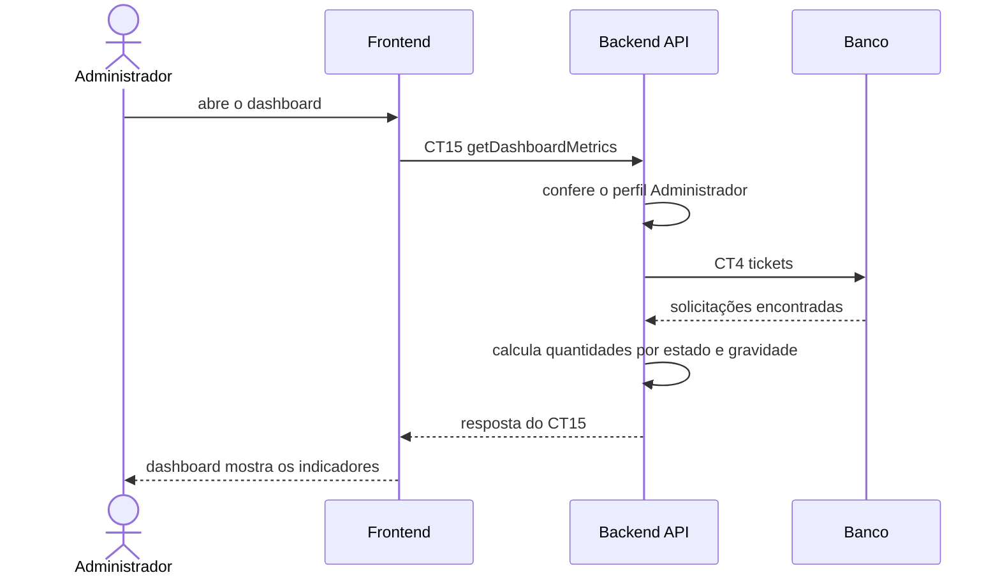

# Fluxo do E8: Dashboard administrativo

**Feito quando (da Entrega 1):** O administrador acessa o dashboard e visualiza indicadores dos atendimentos, como quantidade por estado e gravidade.

> Era o E9 na Entrega 1.

## Passos

1. O administrador abre o dashboard.
2. O Frontend chama o Backend API com a operação `getDashboardMetrics` (CT15).
3. O Backend API confere o perfil Administrador.
4. O Backend API busca as solicitações na tabela `tickets` (CT4).
5. O Backend API calcula a quantidade de solicitações por estado e por gravidade.
6. O Backend API responde ao Frontend com os indicadores.
7. O dashboard mostra os cartões e gráficos com os indicadores.

## Diagrama

## Contratos usados

| ID | Nome | De → Para |
|:---|:---|:---|
| CT15 | `getDashboardMetrics` | Frontend → Backend API |
| CT4 | `tickets` | Backend API → Banco |
