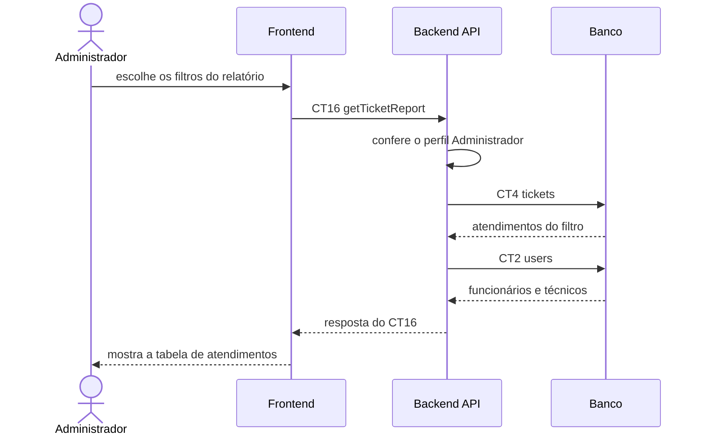

# Fluxo do E9: Relatório de atendimentos

**Feito quando (da Entrega 1):** O administrador consulta os atendimentos realizados e consegue visualizar informações como funcionário, técnico responsável, gravidade, estado e datas do atendimento.

> Era o E10 na Entrega 1.

## Passos

1. O administrador abre o relatório de atendimentos e escolhe os filtros (período, estado, gravidade).
2. O Frontend chama o Backend API com a operação `getTicketReport` (CT16).
3. O Backend API confere o perfil Administrador.
4. O Backend API busca os atendimentos do filtro na tabela `tickets` (CT4).
5. O Backend API busca os nomes do funcionário e do técnico responsável na tabela `users` (CT2).
6. O Backend API responde ao Frontend com o relatório.
7. O Frontend mostra a tabela com funcionário, técnico responsável, gravidade, estado e datas de cada atendimento.

## Diagrama

## Contratos usados

| ID | Nome | De → Para |
|:---|:---|:---|
| CT16 | `getTicketReport` | Frontend → Backend API |
| CT4 | `tickets` | Backend API → Banco |
| CT2 | `users` | Backend API → Banco |
