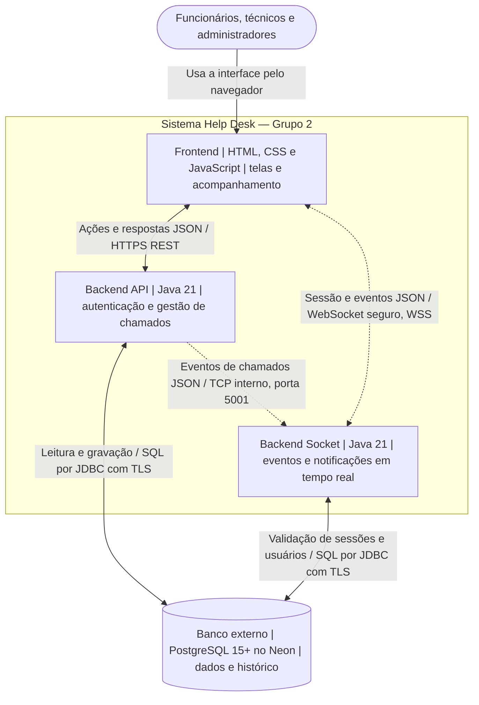

# Visão geral — Help Desk

**Projeto Integrador IV · Grupo 2**

O Help Desk permite que funcionários abram e acompanhem chamados, técnicos atendam as solicitações e administradores gerenciem usuários e o atendimento. Esta página identifica os módulos e suas ligações para orientar os fluxos e contratos.

## Módulos e responsáveis

| Módulo | O que faz | Tecnologia | Repositório | Responsável |
| :--- | :--- | :--- | :--- | :--- |
| Frontend | Apresenta login, cadastro, painel, chamados, histórico e notificações para funcionários, técnicos e administradores. | HTML5, CSS3 e JavaScript nativos | [pi4-0102-g2-frontend](https://github.com/Vinicius-Heinzl/pi4-0102-g2-frontend) | Vinicius Fortes Heinzl |
| Backend API | Autentica usuários, aplica permissões e gerencia chamados, categorias, histórico e notificações persistidas. | Java 21, HTTP REST, Gson e JDBC | [backend-api](https://github.com/Shinypuc/backend-api) | Kaue Rodrigues Seixas |
| Backend Socket | Gerencia conexões concorrentes e distribui notificações e eventos dos chamados às sessões dos usuários. | Java 21, sockets TCP e coleções concorrentes; interface WebSocket pública | [pi4-2026-2-0102-grupo2-backend-socket](https://github.com/cauagreccodev/pi4-2026-2-0102-grupo2-backend-socket) | Cauã Vasconcelos Grecco De Faria |
| Banco de dados — Neon (externo) | Guarda usuários, categorias, chamados, histórico e notificações nas tabelas `users`, `categories`, `tickets`, `ticket_timeline` e `notifications`. | PostgreSQL 15+ gerenciado no Neon | Modelagem junto do [Backend API](https://github.com/Shinypuc/backend-api/blob/main/database_modeling.md); sem repositório próprio | Kaue Rodrigues Seixas |

**Responsáveis sugeridos:** a distribuição considera os proprietários dos três repositórios; o banco foi atribuído ao responsável pela API. É uma proposta para o grupo validar, pois os documentos consultados não formalizam essa divisão.

## Diagrama de contêineres — C4, nível 2

O desenho representa a arquitetura de referência. Cada caixa representa um módulo em execução; o cilindro representa o banco.

A API grava as alterações e as notificações no banco antes de avisar o Backend Socket via TCP interno (CT18). O socket entrega as atualizações aos painéis conectados via WebSocket (CT22); o frontend consulta a API para carregar ou reconciliar os dados e o histórico.

**Integração por WebSocket:** o navegador abre conexões WebSocket na porta pública do Backend Socket (CT19). A conexão direta do Socket com o banco é utilizada para validar a assinatura do token e obter a permissão/perfil (`role`) do usuário na tabela `users` (CT13).

**Serviços externos:** o banco gerenciado no Neon fica fora da moldura. Vercel hospeda o frontend e Render é o destino da API configurado no JavaScript; são plataformas de hospedagem dos módulos. Não foi identificada integração com pagamento, login de terceiros, SMS, e-mail ou API do WhatsApp.

## Convenção de nomes

Nos campos JSON entre módulos usamos nomes em inglês e camelCase (`ticketId`, `supportId`, `createdAt`, `unreadCount`); nas tabelas e colunas do banco, inglês e snake_case (`ticket_timeline`, `support_id`, `created_at`). Operações usam verbo no infinitivo mais o objeto, em inglês e camelCase (`createTicket`, `listTickets`, `updateTicket`). Tipos de eventos usam UPPER_SNAKE_CASE (`STATUS_CHANGE`, `NOTIFICATION_PING`). As rotas REST existentes são preservadas, e a ação é indicada pelo método HTTP. Os textos apresentados ao usuário ficam em português.

**Alinhamento de escopo:** Funcionalidades de chat em tempo real (como Teams/Slack) foram **descartadas** do escopo do projeto para simplificação da entrega (consolidando os 9 entregáveis oficiais: E1 a E9). O Backend Socket atua exclusivamente na orquestração de sessões WebSocket e distribuição de eventos em tempo real dos chamados (`chamadoAtualizado`). A ADR 0001 foi revisada para documentar esse descarte.

